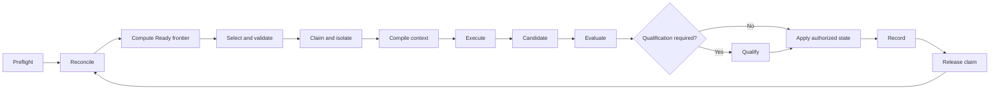
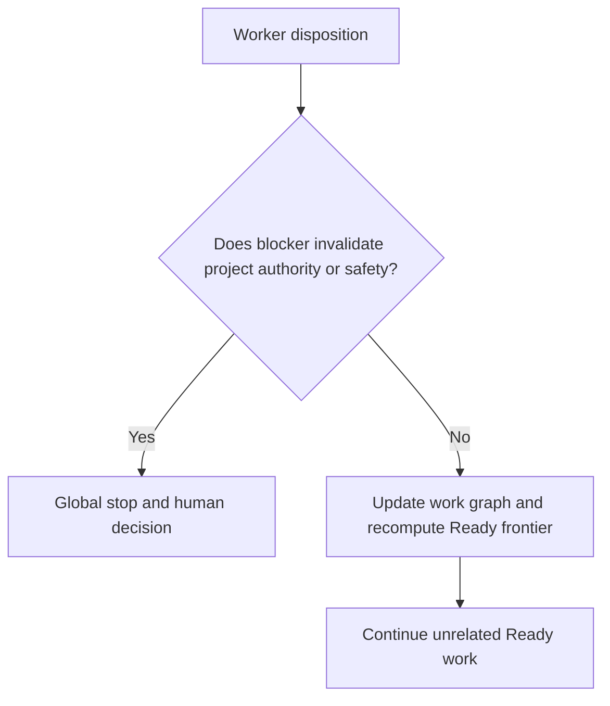

# Execution Pipeline

## Coordinator loop



## Local blocker semantics

A worker may return:

```text
DONE
BLOCKED
FAILED
SUPERSEDED
ABANDONED
WAITING_EXTERNAL
```

The coordinator then asks:

```text
Does this invalidate project-wide authority/safety?
  yes → GLOBAL STOP / human decision
  no  → update graph and recompute Ready frontier
```

Do not turn a local blocker into a conversational project halt.



## Retry

Retry only when:

```text
failure class is retryable
∧ new information or changed state exists
∧ declared recovery exists
∧ retry budget remains
```

Never repeatedly send an unchanged blocker to the same worker.

## Goal sequencing

Before mutation, identify:

```text
prerequisites
ordered work
verification
promotion/evidence
cleanup
```

Continue through obvious lawful successors without waiting for a new prompt.

## Findings outside scope

Classify:

```text
in-scope
related-out-of-scope
decision-required
```

Fix only in-scope findings. Preserve the rest as work/evidence.

## Human decision boundary

Escalation packets should contain:

```text
decision needed
why existing rules cannot decide
affected work
available alternatives
evidence
consequence of no decision
smallest authority change required
```

The human should resolve the governing state, not micromanage implementation.

## Model routing

Use the smallest model that can satisfy the work contract.

```text
deterministic tool / validator first
small model for mechanical bounded work
larger model for unresolved architecture/strategy/contradiction
```

Model tier never grants authority.
