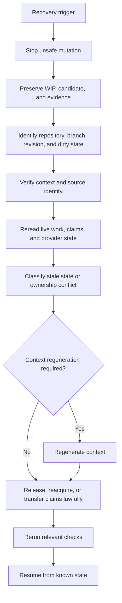

# Recovery

Recovery reconstructs safe operating state from canonical project records rather than hidden conversational memory.

## Recovery triggers

Examples:

```text
stale context lock
stale or orphaned claim
worker termination
branch behind material canonical change
unexpected dirty state
coordination collision
provider state changed beneath a claim
```

## Procedure



Never erase another worker's unknown state as a shortcut to recovery.

Do not force-reset or delete work merely because it is inconvenient.

## Recovery evidence

Record:

```text
trigger
stale/inconsistent state detected
what was preserved
canonical state reconstructed
ownership changes
context changes
checks rerun
supported resumption point
```
