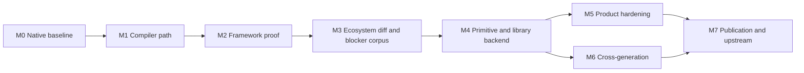

# Project milestone plan

**Status:** canonical proposed milestones; GitHub-native milestone objects and Project board fields must be configured separately. The repository already references **GitHub Project board #44** in `docs/WORK_ITEMS.md`; do not create a duplicate board.

## Delivery map

| Phase | Milestone | Exit evidence | Primary issues | State |
|---|---|---|---|---|
| M0 | Reproducible Maxwell baseline | native CUDA 12.4 per-card tests and evidence | existing CLC-001–004 | initial slice complete (repository record) |
| M1 | Compiler-independent native kernel path | LLVM NVPTX sm_52 PTX, ptxas/driver execution | #9, #29 | initial vector-add complete; expansion open |
| M2 | Verified CUDA 13-era PyTorch bridge | official wheel, selected native ops, bounded fallback, first training probe | #24–#28, #47 | experimental slice demonstrated |
| M3 | CUDA ecosystem research inventory | release diff, ABI/symbol/SM extraction, blocker corpus, source citations | #32, #33, #37, #47 | research active |
| M4 | Shared primitive and library backend | typed semantic registry, BLAS/image/data primitives, correctness harness | #10, #27, #28, #34, #39 | planned |
| M5 | Professional product and instrumentation | safe CLI, doctor/inspect/run, cache, reports, trace/benchmark, rollback | #38, #40–#43, #46 | existing CLI; hardening planned |
| M6 | Cross-generation validation | Maxwell + real Pascal evidence, topology and precision contracts | #7, #13–#18, #35 | planned |
| M7 | Research publication and upstream contribution | reproducible technical reports, qualified upstream issue/PR candidates | #36, #44, #45 | planning documented |

## Critical path

M3 extraction and M5 diagnostics can proceed in parallel; the diagram expresses dependency of *verified claims*, not a prohibition on concurrent engineering.

## Project-board conventions
- **Status:** Backlog, Ready, In progress, Blocked, In review, Done.
- **Priority:** P0–P3 from issue title, not an assumption about existing board fields.
- **Type:** Research, Kernel, Compiler, Adapter, Tooling, Product, Documentation, Upstream.
- **Milestone:** M0–M7; keep existing CLC identifiers in `docs/WORK_ITEMS.md` rather than renumbering.
- **Evidence gate:** Proposed → documented → reproducible → verified on device → published.
- **Links:** every issue should identify source research, implementation owner, acceptance tests, blocker and upstream disposition when relevant.

## Governance and truthfulness
- Existing `docs/roadmap.md` M0–M8 are technical milestones and are **not identical** to this project delivery plan; reconcile names rather than silently overwrite.
- Do not mark a milestone done solely because a document or ticket exists.
- Do not claim GitHub-native milestones were created or issues assigned to them until confirmed through GitHub API.
- Titan Node's production inference must remain unaffected by experiments.
- Publication does not imply external peer review or NVIDIA adoption.

## Immediate board triage
1. P0: #32, #37, #38, #46, #47. Verify actual state before moving to In progress.
2. P0/P1 implementation: #27, #28, #33, #39, #41; require measured operator contracts.
3. Product: #42, #43; extend existing `cuda-legacy` instead of duplicating CLI.
4. Upstream: #44 only after an evidence-backed generalizable improvement is identified.
5. Long-range: #30, #31, #35, #45 remain research/design rather than release blockers.
