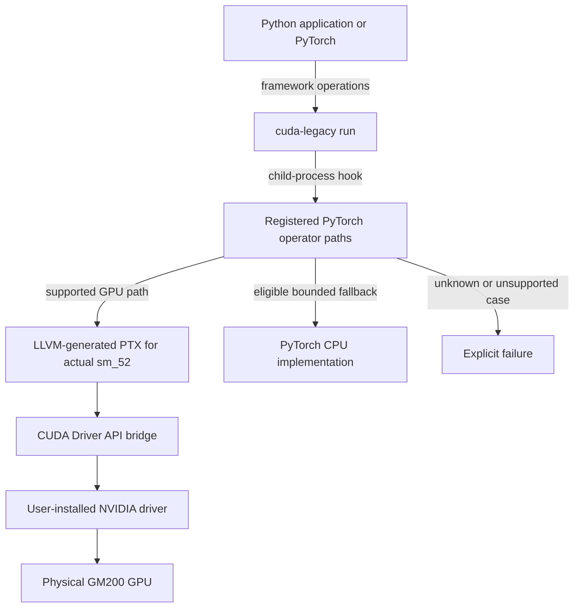

# Architecture

## Product boundary

CUDA Compatibility is a workload compatibility project for older NVIDIA GPUs. It should make software report and use a newer toolkit/API profile only when each exposed behavior has an implementation behind it. The physical GPU identity and compute capability remain accurate. A successful version check is an input to compatibility, never its proof.

The project does not treat NVIDIA's deprecation or architecture cutoff as proof of technical impossibility. For each newer CUDA feature, evaluate native execution, compiler translation, runtime adaptation, library replacement, or software emulation. Software paths may preserve behavior while consuming substantially more time or memory. Physical identity remains real; virtual capability reporting is limited to semantics that the compatibility layer implements and validates.

## Execution layers

The PyTorch CUDA 13 prototype compiles selected source kernels with Clang/LLVM 23.1.4 to actual `sm_52` PTX, then loads them through a small CUDA Driver API bridge against the user-installed CUDA 12.4 driver interface. The short `cuda-legacy run` command is Linux x86_64-only, builds into a temporary directory, and injects an opt-in PyTorch dispatcher bootstrap only into the child process. See the [CLI entry point](../src/cuda_legacy_compat/cli.py), [launcher](../src/cuda_legacy_compat/launch.py), [dispatcher adapter](../src/cuda_legacy_compat/torch_adapter.py), and [packaged compatibility kernels](../src/cuda_legacy_compat/compat/compat_kernels.cu).

Current native paths cover selected float32/int32/float16 addition, float32 in-place addition, arange, embedding, layer normalization, strided 2D matrix multiplication, and ReLU. Selected CPU paths cover linear, batched matrix multiplication, softmax, scaled dot-product attention, GELU, elementwise operations, reductions, concatenation, and contiguous copies. CPU fallback is limited to one CUDA device and 64 MiB of inputs and outputs per operation. First-order autograd plus SGD is experimentally verified only for a 2×2 float32 linear→ReLU→sum training slice; broader models, optimizer modes, and backward graphs are not established. The process-local runtime facade reports CUDA Runtime 13.0 while preserving actual GPU identity and compute capability. This Python package is installed in a chosen Python environment; it is not a machine-wide interposer, and its operator/library coverage remains a bounded experimental subset.

The initial experiment deliberately depends on the last NVIDIA toolchain that emits Maxwell code. Replacing components is a staged goal: Clang/LLVM source frontend first, then PTX lowering/assembly, then selected runtime and library APIs. Do not replace multiple layers at once; the first failing boundary must remain attributable.

## Host language choice

Use Python for the initial CLI, profile parser, diagnostics, compatibility audit, and framework integration. Python is already the natural integration surface for PyTorch and supports rapid evidence-driven iteration. Keep the inspection core on the standard library. Use CUDA C++/PTX for device kernels and LLVM's NVPTX backend for the compiler experiment. Introduce Rust only when measurements identify a long-lived runtime/interposition component that benefits from its ABI and memory-safety properties; a language rewrite is not an objective by itself.

## Compatibility profile semantics

A profile records separately:

- the toolkit/runtime version a package was built against;
- the minimum host toolkit required for local compilation, if any;
- the GPU architectures included in the package;
- the application's actual minimum compute capability;
- APIs and library routines it needs;
- each requirement's implementation status: native, translated, emulated, unsupported, or unknown.

The audit tool reports those dimensions independently. The implemented [process-local version facade](research/runtime-version-facade.md) reports CUDA Runtime 13.0 for one version query; it forwards other calls to the installed runtime and does not implement broad CUDA 13 API semantics. It must not claim a newer compute capability as a shortcut.

## Multi-GPU behavior

Treat every device as a separate memory domain. Work distribution must state whether it duplicates data, shards tensors, or transfers intermediate results. Peer access is unknown until queried on hardware; `nvidia-smi topo` reporting PHB does not prove that CUDA peer access is available. No global-memory pool is presented to applications by default.

## Licensing and distribution boundary

The project code is dual-licensed MIT OR Apache-2.0. Do not include NVIDIA drivers, toolkit binaries, CUDA libraries, headers, or generated proprietary artifacts in releases. Document optional user-supplied dependencies and test against them. Keep third-party sources and generated outputs attributable and license-scanned before a public release.

## Implementation references

- CLI commands and exit behavior: [`cli.py`](../src/cuda_legacy_compat/cli.py), especially `main`.
- Hardware and compiler inventory: [`inventory.py`](../src/cuda_legacy_compat/inventory.py) and the `inspect_system` entry point.
- Profile loading and auditing: [`profiles.py`](../src/cuda_legacy_compat/profiles.py).
- Build and child-process launch: [`launch.py`](../src/cuda_legacy_compat/launch.py), especially `build_adapter` and `launch`.
- Process-start hook and operator dispatch: [`sitecustomize.py`](../src/cuda_legacy_compat/compat/sitecustomize.py) and [`torch_adapter.py`](../src/cuda_legacy_compat/torch_adapter.py).
