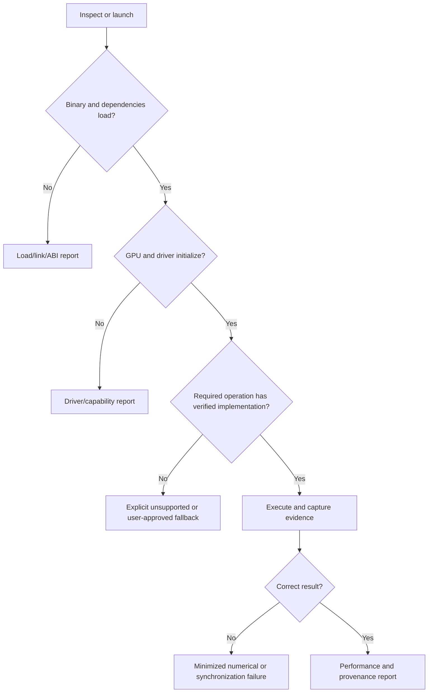

# Product contract: install, discover, inspect, execute, report, rollback

**Status:** design proposal. The commands below are desired UX, not evidence that they currently exist.

## Minimal path
```console
$ cuda-compat install
$ cuda-compat doctor
$ cuda-compat inspect -- python app.py
$ cuda-compat run -- python app.py
$ cuda-compat report --last
```

No step should globally replace NVIDIA drivers, modify system CUDA installations, or rewrite the user's PyTorch environment without explicit consent.

## User journeys

| Step | Inputs | Required output | Failure behavior |
|---|---|---|---|
| Install | platform, selected profile | isolated runtime and manifest | no partial system changes; rollback |
| Doctor | machine environment | GPU, UUID, SM, driver, toolkit, tool support, risk | actionable unsupported state |
| Inspect | command, executable or package | dependencies, GPU images, missing symbols, expected kernels, uncertainty | distinguish static limits from measured failures |
| Negotiate | workload contract + capabilities | verified native/adapter/emulation/fallback/unsupported decisions | mandatory unsupported blocks run |
| Run | original command and profile | application exit status, GPU execution provenance, warnings | preserve original errors plus compatibility context |
| Report | run ID | environment, tests, performance, compatibility decisions | partial report on failure |
| Rollback | installation ID | restore original state | deterministic and safe |

## Diagnostic output example (illustrative)
```text
GPU: NVIDIA GTX TITAN X | Maxwell sm_52 | 12 GiB
Driver: detected; compatibility not yet validated
Runtime: compatibility adapter profile (experimental)
Kernel backend: legacy SM-targeted toolchain
Workload: not yet verified
Blockers: [list of exact missing operations]
CPU fallbacks: disabled by default
Next: cuda-compat inspect -- python app.py
```

## Failure classification


## Profiles
Profiles pin framework, dependencies, driver compatibility assumptions, library adapters, supported operations and kernel versions. They must be signed or checksummed where distribution supports it, with provenance and reversible activation. Profiles are evidence-specific: 'PyTorch supported' is too broad without version, operation, shape and dtype coverage.

## CLI and API contracts
- Consistent `--json`, `--verbose`, `--offline`, `--profile`, `--no-cpu-fallback`, `--dry-run` flags where applicable.
- Stable exit categories: environment invalid, missing dependency, unsupported operation, execution failure, correctness failure, benchmark regression, internal error.
- `doctor` must never install or modify anything.
- `inspect` defaults to nonexecuting static inspection; dynamic probing must be opt-in and isolated.
- `run` must preserve child process exit code where possible and report its own interception failures distinctly.
- No secret/path leakage in shareable reports; redact and preview.
- Machine-readable results must identify evidence status: documented, measured, hypothesis or untested.

## Safety, deployment and lifecycle
- Isolate dynamic library loading and avoid mixed ABI versions unless explicitly verified.
- Avoid invasive `LD_PRELOAD` changes to unrelated processes; use process-scoped launchers.
- Never claim that CUDA 13 binaries will run on Maxwell by default.
- Respect proprietary library licenses and upstream redistribution policies.
- Run GPU diagnostics with resource limits and protect active services; production Titan Node inference is off-limits by default.
- Provide uninstall, rollback, dependency integrity checks and reproducible installation manifests.

## Testable product acceptance
1. New user can discover why a sample workload is unsupported without reading CUDA internals.
2. A supported workload launches unchanged and proves real GPU execution and numerical correctness.
3. A failed workload yields an actionable, redacted report.
4. Installation and removal leave existing driver, CUDA and application environments intact.
5. CLI and future UI derive from the same verified compatibility evidence.

Related: #26, #32, #36–#41.

## Existing CLI reconciliation (added 2026-11-01)

The repository already implements a Python package exposing `cuda-legacy inspect`, `doctor`, `profiles`, `audit`, and an experimental `run`. Consult `README.md` and `docs/user-guide.md` before planning new commands. The illustrative `cuda-compat` syntax above is a **future naming/UX proposal**, not the current executable. The existing launcher is per-process, builds kernels in temporary directories, and uses a bounded PyTorch dispatcher adapter; it is not a general CUDA runtime or machine-wide installer. Work in #42 should converge on existing commands and preserve backward-compatible aliases unless a migration plan is approved.

Implementation entry points: [`cli.py`](../../src/cuda_legacy_compat/cli.py), [`launch.py`](../../src/cuda_legacy_compat/launch.py), and [`torch_adapter.py`](../../src/cuda_legacy_compat/torch_adapter.py).
