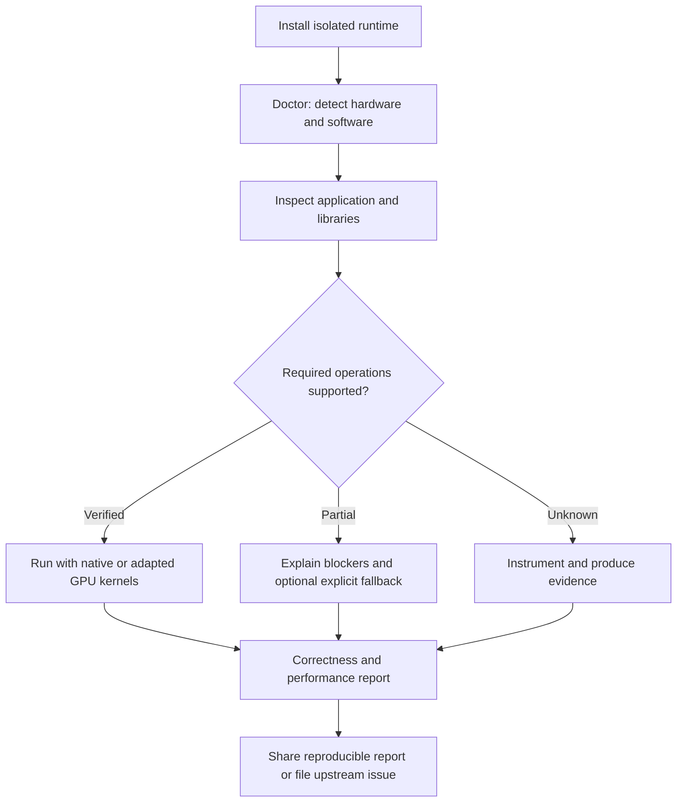
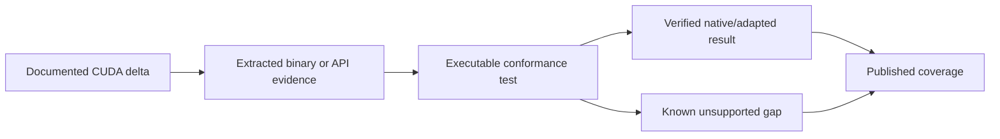

# CUDA Compatibility: product vision and experience

**Status:** proposed product specification, not a statement of implemented capabilities. **Audience:** users, GPU developers, researchers, infrastructure operators, potential upstream maintainers.

## Product thesis
A functioning GPU should not become computationally obsolete merely because a modern software stack stopped targeting it. CUDA Compatibility aims to run **verified subsets** of modern CUDA-era workloads on older NVIDIA GPUs through truthful capability negotiation, modern-facing API/library adapters, native architecture-specific primitives, and measured fallbacks.

Maxwell `sm_52` is the first validation target, not a permanent architecture limit. We do **not** claim universal CUDA 13 binary compatibility, new hardware features, contiguous multi-GPU VRAM, or NVIDIA endorsement.

## Value proposition

| Audience | Existing problem | Proposed value | Evidence required |
|---|---|---|---|
| Individual developer | Working GPU excluded by modern frameworks | Run supported modern workflows without replacing hardware | unchanged workload + GPU trace + numerical checks |
| Research lab / education | Legacy GPU fleets, constrained budgets | More useful life from deployed equipment | per-model reproducible coverage |
| Creative studio | Rendering, image/video tool version incompatibility | Verified visual-computing primitives | image-quality and performance benchmarks |
| Scientific engineer | Numerical library/kernel support ends | Known-good BLAS/FFT/sparse operations | tolerance and determinism reports |
| Infrastructure operator | Fragile CUDA version matrices | Isolated, auditable runtime profiles | safe install/rollback and telemetry |
| Toolchain maintainer | Poor diagnosis of architecture gaps | Reusable extraction, tracing, and regression evidence | upstream-quality reproductions |

## Design principles
1. **Truth before convenience.** Supported, adapted, emulated, CPU fallback, unsupported and untested are distinct statuses.
2. **Preflight before failure.** Explain probable blockers before launching a workload; dynamic behavior can still reveal unknown gaps.
3. **Zero global disruption by default.** No silent driver replacement, system-library overwrite or mutation of production environments.
4. **One-command happy path.** Guided install → doctor → inspect → run; preserve explicit advanced controls.
5. **Performance is observable.** Show the cost of compatibility and separate GPU compute from transfers and compilation.
6. **Native-first execution.** Reuse supported kernels, recompile when possible, substitute verified native kernels, then consider controlled fallback.
7. **Architecture-independent semantics.** Operations describe what must happen; backends describe how it happens.
8. **Useful even without compatibility.** Inspection, ABI diffing, profiling and reporting should benefit modern GPU developers too.
9. **Upstream-friendly.** Reproduce problems, publish minimal tests, and contribute generic fixes to original projects where welcomed.
10. **No endorsement confusion.** Professional NVIDIA-caliber design; independent project identity and clear trademark/affiliation notices.

## Experience flow

## Compatibility states

| State | Meaning | User-facing treatment |
|---|---|---|
| Native | Existing GPU executable verified | Ready |
| Adapted | Compatible replacement/adapter validated | Ready with adaptation disclosure |
| Emulated | Semantics reproduced with measured overhead | Opt-in when relevant |
| CPU fallback | Operation runs on CPU, not GPU | Clearly disclosed and policy-controlled |
| Unsupported | Required semantics unavailable | Block with actionable reason |
| Untested | Insufficient evidence | Do not advertise compatibility |

**No scalar compatibility score is sufficient:** a single mandatory unsupported operation can block a workload. Coverage visualizations must include critical blockers, denominators, evidence dates, tested versions, and confidence.

## Proposed product surfaces

| Surface | Priority | User outcome | Definition of done |
|---|---|---|---|
| `install` | P0 | Reproducible isolated setup | reversible, signed/verifiable artifacts when available |
| `doctor` | P0 | Explain driver/GPU/toolchain readiness | actionable environment report |
| `inspect` | P0 | Find binaries, symbols, SM targets and likely blockers | machine-readable inventory |
| `run -- <command>` | P0 | Launch known-supported workloads | truthful routing and diagnostics |
| Application profiles | P0 | One-step known-working setups | pinned tested matrix |
| `report` | P0 | Explain behavior and evidence | JSON + human-readable |
| `trace` | P1 | Debug launch and runtime failures | correlated events, support-qualified |
| `benchmark` | P1 | Compare costs and regressions | reproducible baselines |
| `diff` | P1 | Compare CUDA releases and components | ABI/API/library/SM evidence |
| Graphical dashboard | P2 | Explore compatibility visually | same data as CLI, no false claims |
| Container integration | P2 | Portable deployments | documented driver/runtime boundaries |

## Product quality standard
- Clear, concise diagnostics with exact failure stage and suggested next action.
- Consistent CLI output, stable JSON schemas, exit codes, and shell completion.
- Offline and privacy-preserving operation by default; no telemetry without informed opt-in.
- Provenance for tool versions, artifacts, driver, GPU identity and benchmark environment.
- Accessibility, dark/light themes, readable tables, searchable docs, examples and compatibility recipes.
- Versioned support matrices and release notes; regressions are release blockers.
- Avoid copying NVIDIA logos, UI assets, proprietary source, or suggesting NVIDIA sponsorship.

## Evidence-backed progress visualization

Metrics to publish: operation coverage by required workload; library API coverage; native/adapted/emulated/CPU proportions; pass/fail tests; latency and throughput deltas; peak VRAM; environment support; regressions; upstream accepted fixes. **Never populate charts with hypothetical values presented as measurements.**

## Scope and relationships
Technical architecture: #24–#35. Research and evidence: #32, #36–#41. Product contract: [product-contract.md](product-contract.md). Upstream strategy: [upstream-contributions.md](../strategy/upstream-contributions.md).
