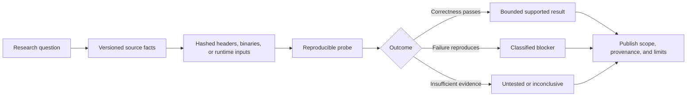

# Official research program: CUDA Compatibility

**Status:** canonical research charter and publication index. **Established:** 2026-11-01. This is project-maintained research, not an NVIDIA-endorsed or peer-reviewed publication.

## Research question
To what extent can modern CUDA-era computational semantics be preserved on GPUs whose architecture is no longer targeted by contemporary NVIDIA toolchains and libraries, using verifiable adapters, architecture-specific kernels and explicit capability negotiation?

## Hypotheses and falsification

| ID | Hypothesis | Experiment | Failure criterion |
|---|---|---|---|
| H1 | Selected CUDA 13-era PyTorch operations can execute correctly on GM200 without application source changes | pinned wheel, scoped launcher, native PTX, CPU oracle | output mismatch, unreported fallback, no device execution |
| H2 | A reusable Maxwell primitive library reduces per-application adapter work | BLAS/image/data/AI operator families | implementation remains framework-specific or correctness fails |
| H3 | Modern-facing library adapters can preserve bounded semantics using legacy implementations | cuBLAS/FFT/NPP compatibility probes | ABI, stream, precision or resource contract mismatch |
| H4 | Preflight + runtime evidence predicts support more reliably than toolkit-version gates | workload inspection vs measured traces | false supported status on mandatory operation |
| H5 | Architecture-neutral operation contracts can be implemented on Pascal and beyond | second physical GPU validation | semantic contract requires Maxwell-only assumptions |
| H6 | GPU-native paths offer meaningful benefit over explicit CPU fallback | cold/warm, transfer, kernel and end-to-end benchmarks | transfer/dispatch cost dominates or fails workload objective |

## Existing evidence (not newly executed here)

| Evidence | Observation | Limit |
|---|---|---|
| [Maxwell baseline](maxwell-baseline.md) | native CUDA 12.4 vector-add on three GM200 devices | not CUDA 12.9 or 13 kernel compiler support |
| [LLVM NVPTX experiment](llvm-nvptx.md) | LLVM 23.1.4 PTX targeting sm_52, assembly/JIT and per-card run | bounded kernel, not universal compilation |
| [PyTorch CUDA 13 on Maxwell](pytorch-cu130-maxwell.md) | official 2.14.0+cu130 wheel, selected native operations, bounded fallbacks, small model/training probes | no general cuBLAS/cuDNN or arbitrary app support |
| [Implementation gap audit](implementation-gap-audit-2026-11-01.md) | source-level review of CLI, launcher, bridge, dispatch and evidence | no new hardware execution |
| [CUDA release comparison](../compatibility/cuda-12.9-to-13.0-primary-source-diff.md) | release-note-based version/change register | header, symbol and binary diff still pending |

## Method and reproducibility requirements
1. **Provenance:** exact toolkit and component versions, wheel hashes, driver, GPU UUID, SM, OS, compiler, library paths and source commit.
2. **Classification:** documented (primary-source), observed (raw output), inferred (reasoned), proposed (untested), unsupported (tested negative).
3. **Controls:** native legacy GPU kernel; stock modern application failure; CPU reference; adapted execution; negative controls.
4. **Correctness:** shape/stride/dtype/aliasing/stream semantics, numerical tolerances, NaN/Inf, gradients where claimed, seeded cases and failure minimization.
5. **Performance:** separate compile/cold-start, warm execution, H2D/D2H, kernel time, end-to-end time, memory and multi-GPU topology.
6. **Evidence integrity:** preserve logs/hashes, link exact commands, redact host secrets, never redistribute NVIDIA binaries in violation of licenses.
7. **Claim scope:** no universal CUDA 13 compatibility, native BF16/tensor cores, contiguous pooled VRAM, or NVIDIA affiliation.

## Workstreams

| Workstream | Questions | Tickets |
|---|---|---|
| W1 Release/API/ABI archaeology | What changed between 12.9 and 13.0? | #32, #37 |
| W2 Compiler and binary execution | Which representations can be recompiled/lowered for sm_52? | #9, #29–#31 |
| W3 Library compatibility | Which cuBLAS/cuFFT/cuDNN/NPP contracts can be adapted? | #33, #47 |
| W4 Computational primitives | Which operations are reusable across domains? | #10, #27, #28, #34 |
| W5 Instrumentation and validation | How can we prove correctness, GPU execution and cost? | #13, #38–#41 |
| W6 Architecture portability | Does the model generalize to Pascal and beyond? | #7, #14–#17, #35 |
| W7 Product and upstream adoption | Can ordinary users install, diagnose and run safely? | #42–#46 |

## Research outputs
- **Research notes:** `docs/research/` with date, method, environment, claims and limitations.
- **Raw evidence:** `records/evidence.jsonl`, `records/negative-results.jsonl` and reproducible scripts.
- **Specifications:** `docs/architecture/`, `docs/compatibility/` and `docs/product/`.
- **Publication candidates:** research papers, benchmark datasets, technical reports and upstream issues/PRs only after source and evidence review.
- **Tracking:** existing GitHub project board #44 and milestone plan in [PROJECT_MILESTONES.md](../PROJECT_MILESTONES.md). This file does not assert GitHub milestone objects exist.

## Publication gate
A research result is publication-ready only when the exact commit, artifacts, independent rerun instructions, baseline, numerical/behavioral tests, limitations and reviewer sign-off are available. Distinguish original project findings from NVIDIA documentation and independent upstream work.
