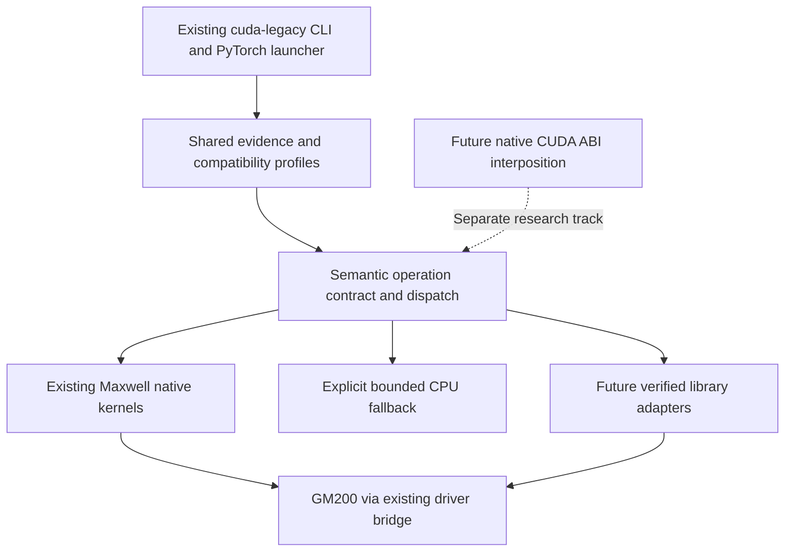

# Implementation gap audit: current prototype vs platform ambition

**Date:** 2026-11-01. **Method:** repository source inspection (README, architecture, user guide, roadmap, `launch.py`, `cli.py`, `torch_adapter.py`, existing experiment records). **Not a fresh Titan execution or test run.**

## Executive conclusion
The project already has a working, bounded *PyTorch dispatcher-level* compatibility prototype on Maxwell. The highest-leverage work is to harden and generalize the existing path, not create a parallel CLI, loader or compiler. The compatibility layer is currently **application/framework-aware**, not a general CUDA 13 ABI implementation.

## Implementation and evidence matrix

| Capability | Source implementation | Observed evidence | Important boundary | Recommended action |
|---|---|---|---|---|
| GPU inventory | [`inventory.py`](../../src/cuda_legacy_compat/inventory.py), [`cli.py`](../../src/cuda_legacy_compat/cli.py) | three physical GM200 devices | not a full device/driver conformance check | enrich provenance, UUID mapping |
| Profile browsing and audit | [`profiles.py`](../../src/cuda_legacy_compat/profiles.py), [`cli.py`](../../src/cuda_legacy_compat/cli.py) | package architecture gates | profile 'compatible' does not certify execution | distinguish preflight and workload evidence |
| Doctor | [`cli.py`](../../src/cuda_legacy_compat/cli.py) | checks OS/Python/torch/GPU/LLVM/headers/driver | `ready` only prerequisites | machine-readable remediation and confidence |
| Per-process launcher | [`launch.py`](../../src/cuda_legacy_compat/launch.py) | PyTorch wheel probes | Python-only; compiles every launch; modifies child env | preserve CLI, add artifact caching and rollback tests |
| NVPTX compilation | [`launch.py`](../../src/cuda_legacy_compat/launch.py), [`compat_kernels.cu`](../../src/cuda_legacy_compat/compat/compat_kernels.cu) | LLVM 23.1.4 PTX 8.4 for `sm_52` | exact toolchain pinned; CUDA 12.4 headers | reproducible build manifest and multi-toolchain tests |
| CUDA driver bridge | [`driver_add_bridge.cpp`](../../src/cuda_legacy_compat/compat/driver_add_bridge.cpp) | module caching, streams and GPU kernels | custom per-operation ABI, not general runtime translation | typed operation ABI and resource ownership tests |
| Runtime version facade | [`cuda_runtime_version_facade.cpp`](../../src/cuda_legacy_compat/compat/cuda_runtime_version_facade.cpp) | process-local CUDA 13 version response | one query is not CUDA 13 semantics | gate facade by supported profile; disclose behavior |
| PyTorch dispatcher adapter | [`torch_adapter.py`](../../src/cuda_legacy_compat/torch_adapter.py) | selected add/mm/relu/etc | tied to ATen, shape/dtype limits | extract reusable semantic operation registry |
| Native kernel execution | [`compat_kernels.cu`](../../src/cuda_legacy_compat/compat/compat_kernels.cu) | selected float16/float32/int32 and small MLP | not general kernel-image translation | operator-by-operator conformance |
| CPU fallback | [`torch_adapter.py`](../../src/cuda_legacy_compat/torch_adapter.py) | bounded inference, tiny autograd path | max 64 MiB, may be slow; not GPU execution | policy-controlled, report every transfer and fallback |
| cuBLAS | stock `cublasCreate` error recorded | `CUBLAS_STATUS_ARCH_MISMATCH` | no broad cuBLAS adapter | prioritize BLAS contract mapping |
| cuDNN | stock engine selection failure recorded | one CNN with CPU fallback | no native convolution path proven | prioritize NPP/convolution primitive feasibility |
| Multi-GPU | separate per-card tests | physical P2P unknown, PHB topology | no logical pooled memory or scheduling | explicit peer queries and scaling tests |
| Instrumentation | research scripts and records | limited trace, timing and library map | no unified binary/ABI extraction or ledger | build #37–#41 around existing evidence |
| Product distribution | Python package in target environment | CLI installed, reversible by environment removal | no standalone installer/container integration | evolve #42 without breaking `cuda-legacy` |

## Architecture transition

**Do not collapse** Python ATen dispatch, runtime/driver ABI interposition, PTX lowering and binary translation into a single claim of 'transparent CUDA 13 support'. They differ in available semantic information and deployment difficulty.

## Highest-value engineering priorities

| Rank | Work | Why now | Evidence gate |
|---|---|---|---|
| 1 | Convert actual failing operations to a pinned blocker corpus (#47) | already observed: add missing image, cuBLAS ARCH_MISMATCH, cuDNN engine failure | deterministic repro + exact environment |
| 2 | Build per-op dispatch provenance and capability contract (#28, #41) | makes correctness and fallback auditable | machine-readable selected implementation per operation |
| 3 | Extract and benchmark reusable BLAS and image primitives (#27, #33, #34) | cross-domain reuse and performance impact | GPU-native reference comparison |
| 4 | Cache and isolate compilation artifacts (#9, #42) | improves one-command experience and reproducibility | deterministic artifact hash, cold/warm timing, no global changes |
| 5 | Build actual 12.9/13.0 ABI and binary inventories (#32, #37) | turns ecosystem diff into executable backlog | signed/versioned artifact manifests |
| 6 | Qualify Maxwell debugger/profiler support (#38–#40) | modern tools may not support GM200 | hardware tool/version matrix |
| 7 | Expand workload profiles and upstream candidate review (#43, #44) | moves from prototype to usable product | verified tests, maintainer-aligned repro |

## Specific technical risks to investigate
- [`launch.py`](../../src/cuda_legacy_compat/launch.py) compiles kernels and native shared libraries in a fresh temporary directory on **every** invocation. Measure startup costs and design a safe content-addressed cache; preserve temporary isolation and cleanup.
- The [driver bridge](../../src/cuda_legacy_compat/compat/driver_add_bridge.cpp) uses custom `ctypes` function declarations per operator; mismatched signatures, pointer lifetime, stream ownership and module caching are high-risk boundaries. Add ABI and concurrency tests before large-scale expansion.
- `LD_PRELOAD` is inherited only by the launched child but may affect its subprocesses; scope and document this behavior. Existing inherited `LD_PRELOAD` and `PYTHONPATH` need explicit compatibility and security tests.
- The [`torch_adapter.py`](../../src/cuda_legacy_compat/torch_adapter.py) module combines operation semantics, dispatch policy, bridge invocation and CPU fallback. Refactor only with characterization tests to preserve proven behavior.
- CPU fallback can preserve some numerical results while introducing transfers, synchronization and autograd differences. Report *both* GPU execution fraction and end-to-end performance; never label a CPU-backed workload GPU-native.
- The current adapter requires every visible GPU to be `sm_52`; heterogeneous hosts and UUID-based selection are separate qualification tasks.
- Avoid a universal 'CUDA 13 supported' status; pin PyTorch wheel, driver, toolkit, GPU, operation, shape, dtype and fallback policy.

## Documentation debt found
- New [product contract](../product/product-contract.md) illustrates `cuda-compat`, while the shipped command is `cuda-legacy`. Treat the former as proposed UX, not a parallel implementation.
- New `docs/compatibility/research-log.md` initially marked all GM200 runtime probes pending despite existing records; correction appended.
- The 12.9→13.0 register is a **release-note** comparison; actual host experiments currently use CUDA 12.4 development files. Do not present them as a completed 12.9→13.0 binary comparison.

## Immediate experiments (isolated)
1. Run `make check`, `make test` and repository validators before refactoring.
2. Benchmark cold/warm `cuda-legacy run` startup on one non-production GPU.
3. Instrument selected ATen operations with backend path, device ID, bytes moved, kernel duration and CPU fallback.
4. Reproduce stock failures with matching wheel and record loaded library paths.
5. Implement one BLAS adapter or high-value Maxwell GEMM with tests; compare against existing naive matrix kernel and CPU baseline.
6. Compare first image/convolution kernel against existing CPU fallback; do not claim cuDNN compatibility from one convolution.

## Source references
- [README](../../README.md)
- [Architecture](../architecture.md)
- [User guide](../user-guide.md)
- [Roadmap](../roadmap.md)
- [Maxwell baseline](maxwell-baseline.md)
- [PyTorch CUDA 13 on Maxwell](pytorch-cu130-maxwell.md)
- [Launcher](../../src/cuda_legacy_compat/launch.py)
- [CLI](../../src/cuda_legacy_compat/cli.py)
- [PyTorch adapter](../../src/cuda_legacy_compat/torch_adapter.py)

All recommendations are hypotheses or planned improvements until tested; existing execution claims refer to repository-recorded evidence.
