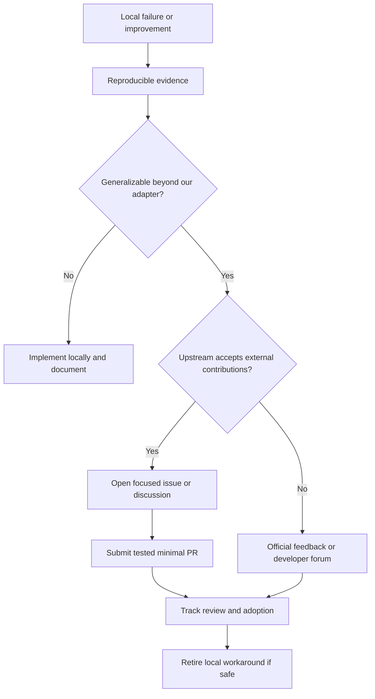

# Upstream collaboration and contribution strategy

**Status:** proposed policy. Independent project; not affiliated with or endorsed by NVIDIA.

## Strategic goal
Build high-quality compatibility, inspection, debugging and numerical tooling that NVIDIA and maintainers of relevant open-source projects would find useful. Where improvements are generalizable, prefer upstream contributions over maintaining permanent forks. Do not create PRs merely for visibility; submit when the change is technically sound, appropriately scoped, licensed and welcomed.

## Contribution targets and candidate improvements

| Upstream | Candidate contribution | Why it helps CUDA Compatibility | Preconditions |
|---|---|---|---|
| NVIDIA CUDA samples (where publicly contributable) | better architecture-gating examples and clear diagnostics | demonstrates safe feature detection | repo policy and reproducer |
| NVIDIA Compute Sanitizer / CUPTI feedback channels | minimal Maxwell/version support diagnostics and API regression reports | improves traceability | official supported issue channel |
| NVIDIA documentation / forums | precise compatibility and migration findings | reduces ambiguity about support boundaries | verified source-backed finding |
| PyTorch | clearer missing-SM errors, backend fallback diagnostics, test fixtures | makes failures actionable | accepted scope, maintainer discussion |
| llama.cpp | device capability detection, benchmark correctness, diagnostics | protects legacy inference paths | benchmark + supported configuration |
| CMake / build tooling | clearer CUDA architecture checks and failure messages | makes cross-toolchain builds reproducible | minimal cross-platform test |
| CCCL / Thrust / CUB | generic correctness tests or architecture-aware diagnostics | improves shared primitives | target support policy verified |
| OpenCV / scientific libraries | fallback contracts and GPU support diagnostics | expands visual/scientific workloads | library-specific acceptance criteria |

NVIDIA's proprietary CUDA toolkit, driver and closed libraries generally cannot be modified through ordinary public GitHub pull requests. Use official feedback channels, developer forums or documented contribution repositories instead. Check repository contribution rules and CLAs before opening issues or PRs.

## Decision funnel

## Required upstream ticket / PR package
- Problem statement and affected exact versions/architectures.
- Minimal standalone reproducer with expected/actual output.
- Logs, binary/API provenance and a correctness test; redact sensitive information.
- Why this is an upstream concern rather than only a legacy GPU workaround.
- Proposed change, alternatives, regression risk and benchmark data where relevant.
- Licensing, code-of-conduct, contribution guidelines and CLA checks.
- Link to our internal tracking issue, upstream issue/PR, reviewer feedback and eventual outcome.

## Priority rubric

| Criterion | Weight in decision |
|---|---|
| Directly removes a blocker for our users | Highest |
| General value to supported architectures | High |
| Reproducible and testable | Mandatory |
| Maintainer alignment / public contribution path | Mandatory |
| Low ongoing maintenance burden | High |
| Positive performance/correctness evidence | High |
| Public visibility alone | Not sufficient |

## Collaboration and brand
Aim for NVIDIA-quality engineering, documentation, diagnostics and design; do not imply certification, partnership, sponsorship or endorsement. Use an independent name, logo, product identity and clear attribution. If NVIDIA or another vendor expresses interest, establish contribution, governance, compatibility claims and licensing explicitly.

## Operating cadence
- During research: tag findings `upstream-candidate` in the evidence ledger.
- At each verified blocker: evaluate whether a generalizable fix exists.
- Before PR: inspect active upstream issues and maintainer policy; coordinate before large changes.
- After merge: update our compatibility matrix, tests and documentation; remove redundant shims only after validation.
- Track upstream outcomes: proposed, accepted for discussion, PR open, merged, rejected, superseded, downstream-only.

Related: #32, #36–#41.
