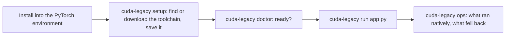

# CUDA Compatibility user guide

CUDA Compatibility is an experimental tool for running selected PyTorch CUDA 13 operations on NVIDIA `sm_52` GPUs. The short command is `cuda-legacy`; `cuda-legacy-compat` remains available as an alias. Today, setup installs a Python package in one environment and `cuda-legacy run` adapts one Python process. It does not install a machine-wide shim or make every CUDA 13 application compatible.

## 1. Install and set up

On Linux x86_64, one command installs the release into the environment that holds your PyTorch CUDA wheel and runs `cuda-legacy setup`. With no such environment, it offers to create `~/torch-cu130` with torch 2.14.0+cu130, the wheel the adapter is qualified on (about 3 GB to download, 5.3 GB on disk):

```sh
curl -fsSL https://cudacompat.com/install.sh | sh
```

The installer checks the release archive's SHA-256 before installing it and never uses sudo. Run it as your own user. Inside a container (Docker or Podman) running as root is fine; on another disposable machine where root is the only user, add `--allow-root`. It refuses `sudo`, because pip would leave root-owned files in your environment and home. It doesn't change drivers, the system CUDA install or the system Python. Read [install.sh](https://cudacompat.com/install.sh) first and compare it with [its checksum](https://cudacompat.com/install.sh.sha256). Options go after `sh -s --`:

| Option | Effect |
|---|---|
| `--dry-run` | Print each step without changing anything |
| `--python PATH` | Use this environment's Python instead of the one the installer finds |
| `--yes` | Don't ask before downloading PyTorch (when no environment has it) or LLVM |
| `--uninstall` | Remove what setup created, then uninstall the package |
| `--allow-root` | Run as root outside a container, on a disposable machine; never accepted with `sudo` |

Exit code 0 means ready. Exit 1 means the package is installed but setup lists what still needs attention. Exit 2 means it stopped; the message says why. To upgrade, run the same command again: it replaces the package and keeps the saved setup.

If `cudacompat.com` refuses the download (curl prints an HTTP error such as 403 or 429, and nothing runs), fetch the same script from GitHub and check it against its checksum before running it:

```sh
curl -fsSLO https://raw.githubusercontent.com/zachshallbetter/cuda-compatibility/main/site/install.sh
curl -fsSL https://raw.githubusercontent.com/zachshallbetter/cuda-compatibility/main/site/install.sh.sha256 | sha256sum -c - && sh install.sh
```

### Set up by hand

From a source checkout, install into the environment that holds PyTorch, then run setup once:

```sh
python3 -m venv .venv
. .venv/bin/activate
python -m pip install .
cuda-legacy setup
```

`setup` finds the PyTorch environment and the CUDA 12.4 headers. Without system headers, it fetches them after asking from NVIDIA's own CUDA 12.4 wheels on PyPI (83 MB, SHA-256 checked, under NVIDIA's license) and keeps about 47 MB. It uses LLVM 23.1.4 if you have it, or downloads it after asking, with a SHA-256 check. It saves the result, so `doctor` and `run` need no flags afterwards. `cuda-legacy setup --dry-run` shows the plan first. `cuda-legacy setup --remove` deletes exactly what setup created. It leaves `~/.nv/ComputeCache`, the NVIDIA driver's compile cache that every CUDA program shares; delete it yourself if you want. If you first ran setup with 0.2.0 in a home directory that had no `~/.config` or `~/.local/share`, those two folders stay behind, empty: 0.2.0 did not record that it made them, so later versions cannot tell them from your own.

For development, use `python -m pip install -e .`. The package has no Python runtime dependencies and bundles no NVIDIA files. Install it into the same environment as the PyTorch CUDA wheel you want to run; the launcher uses that environment's Python interpreter.

### Where the command is installed

- **Recommended — project environment:** install into the active `venv` or Conda environment that already contains the target PyTorch wheel. On Linux, the command is placed in that environment's `bin/` directory (for example, `.venv/bin/cuda-legacy`); activating the environment puts it on `PATH`.
- **User site — only when that Python already has PyTorch:** outside a virtual environment, `python3 -m pip install --user .` puts the command in Python's user scripts directory. Find the base with `python3 -m site --user-base`; on many Linux systems the scripts directory is `~/.local/bin`. Add that directory to `PATH` if needed. Python ignores `--user` installs inside an active virtual environment.
- **System directories:** this project does not install to `/usr/local/bin` or modify system Python. Avoid `sudo pip install`.

`pipx` and Homebrew give the command its own isolated Python environment, which does not contain PyTorch. That works when you point the tool at your PyTorch environment once: `cuda-legacy setup --python /path/to/your-env/bin/python` saves it for `doctor` and `run`. A `--python` flag or `CUDA_COMPAT_PYTHON` still overrides the saved setup. Without it, `run` starts scripts with the interpreter that runs `cuda-legacy`, and `doctor` inspects that interpreter for PyTorch.

The inventory and profile commands work without an NVIDIA GPU. The adapter has been tested only on Linux x86_64 with Python 3.10.12, official `torch 2.14.0+cu130`, CUDA Runtime 13.0.96, LLVM/Clang 23.1.4, CUDA 12.4 development headers, the NVIDIA 580.178.04 driver, and GTX TITAN X GM200 cards at `sm_52`. Other combinations are not yet qualified.



## 2. Check the machine and available targets

```sh
cuda-legacy inspect
cuda-legacy profiles list
cuda-legacy profiles show pytorch-2.14-cu130
cuda-legacy setup
cuda-legacy doctor
cuda-legacy ops
cuda-legacy audit pytorch-2.14-cu130
```

- `inspect` prints the GPU and `nvcc` inventory it can discover.
- `profiles list` shows the packaged target profiles. `profiles show` prints a profile's source, CUDA package version, and minimum GPU capability.
- `setup` finds the PyTorch environment and CUDA headers, uses or downloads LLVM 23.1.4 (official archive, SHA-256 checked, about 370 MB kept under `~/.local/share/cuda-legacy`), saves the choices to `~/.config/cuda-legacy/config.json`, and runs `doctor`. It asks before downloading; `--yes` skips the question and `--dry-run` only shows the plan. `setup --remove` deletes exactly what it created. It never installs drivers, changes the system CUDA install or edits the PyTorch environment.
- `ops` lists the operations the adapter runs natively on `sm_52`, those it runs through the CPU fallback, and each limit (`--json` for machines). Anything not listed runs as the stock wheel does.
- `doctor` checks the launcher prerequisites: Linux x86_64, Python, a CUDA-enabled PyTorch build, visible `sm_52` GPU(s), LLVM 23.1.4, CUDA headers, `g++`, and the CUDA Driver API library. It honors numeric `CUDA_VISIBLE_DEVICES` selections so a mixed-GPU host can check the same devices intended for `run`. UUID selectors cannot yet be mapped to the `nvidia-smi` inventory and are reported as unverified. After `setup`, `doctor` and `run` need no flags. `--llvm-root`, `--cuda-root` and `--python` (or `CUDA_COMPAT_LLVM_ROOT`, `CUDA_COMPAT_CUDA_ROOT` and `CUDA_COMPAT_PYTHON`) override the saved setup.
- `audit` compares a machine inventory with the profile's published package requirements. `compatible` only means the checked profile fields pass; it does not mean the package's operators or models have been tested on that machine.

The JSON forms are available as `inspect --json`, `profiles list --json`, `profiles show <profile> --json`, and `doctor --json`. `inspect` always returns JSON. `audit` always returns JSON.

`setup` exits 0 when it saved everything and doctor is ready, 1 when it saved but doctor still lists items to fix, and 2 when it stopped before saving; `setup --dry-run` returns the code a real run would. A saved setup that can't be read is reported by `doctor` and `run`. `doctor` uses exit 0 when every prerequisite check is ready and 1 otherwise. Its `ready` status is not a workload certification. `audit` uses 0 for compatible, 1 for incompatible, 2 for an unreadable/invalid profile, and 3 when a required fact is unknown. `profiles` uses 0 on success and 2 when a profile cannot be found or read.

## 3. Run a Python application

After `setup`, pass the application and its arguments. `run` takes a script, `-m MODULE`, `-c CODE` or `-i` as `python` does, so modules, test runners and an interactive prompt work too:

```sh
cuda-legacy run path/to/app.py --application-option value
cuda-legacy run -m mypackage.train      # a module, like python -m
cuda-legacy run -m pytest tests/
cuda-legacy run -c "import torch; print(torch.ones(2).cuda() * 2)"
cuda-legacy run -i                      # an interactive prompt
```

Under the adapter, PyTorch's own warning that `sm_52` is unsupported is replaced by one line saying the adapter is active; set `CUDA_COMPAT_VERBOSE=1` to see PyTorch's warnings.

The command compiles selected kernels for the real `sm_52` target, builds a driver bridge and a CUDA Runtime version-query facade in a temporary directory, then starts the program as a child Python process. Temporary build files are removed when it exits. The facade changes the runtime-version response in that child process; the GPU name, compute capability, and driver remain genuine. The parent shell, other applications, installed PyTorch wheel, NVIDIA driver, and CUDA toolkit are not modified.

The launcher inherits the parent environment and adds `LD_PRELOAD` and Python startup configuration for the child. Use it only with scripts you trust. The current adapter also requires all visible GPUs to report compute capability 5.2.

`run` returns the application process's exit code, or 128 + N when signal N ended it, as a shell does. A launcher/preflight error returns 2. Ctrl-C reaches the program, so a script that catches it (to save a checkpoint, say) finishes its handler; `SIGTERM` or `SIGHUP` sent to the launcher is passed on to the program. This is still a per-process Python entry point; native executables, statically linked CUDA programs, other GPU architectures, and arbitrary libraries are outside the verified scope.

## What the current adapter covers

The adapter has bounded native Maxwell paths for selected float32/int32/float16 addition, float32 in-place addition, arange, embedding, layer normalization, strided matrix multiplication, and ReLU operations. It also has CPU fallbacks for selected operators and recognized missing-image, architecture, and missing-kernel errors. CPU fallback is limited to one CUDA device and 64 MiB of input and output per operation. Creating a tensor directly on the GPU (`torch.zeros`, `ones`, `full`, `rand`, `randn`, `eye` and the like with `device="cuda"`) builds it on the CPU and copies it over, within the same limit; random values then come from the CPU generator, so `torch.manual_seed` keeps them reproducible but they differ from a GPU that has kernels. In-place operations (`x += 1`, `mul_`, `zero_`, `fill_`, `x[i] = v`, `relu_`, `nn.ReLU(inplace=True)`, and the `GradScaler` steps of `torch.amp` mixed precision) run on a CPU copy and are copied back, within the same limit; a strided view such as `x[:, 1:3].zero_()` or `x.t().mul_(2)` is updated through its contiguous base. Other mutating or alias-returning operations fail closed. Training is verified against the CPU for small Linear/GELU MLPs with SGD, momentum SGD, Adam and AdamW (their default `foreach` updates included) for a Conv2d/BatchNorm2d/MaxPool CNN with momentum SGD, parameters and BatchNorm running statistics alike, and for `nn.LSTM`, `nn.GRU` and `nn.RNN` (one and two layers, bidirectional, with and without bias): their CUDA-only fused cells run on the CPU. cuDNN is switched off under the adapter, because the CUDA 13 wheels have no Maxwell cuDNN. Training through `layer_norm`, `scaled_dot_product_attention` and `contiguous` uses PyTorch's own decomposition, so Transformers, `nn.MultiheadAttention` and LayerNorm models train (verified against the CPU for a `TransformerEncoderLayer` with SGD and AdamW, attention with SGD and a LayerNorm MLP with AdamW); attention runs on PyTorch's math backend. Inference keeps the adapter's kernels for them. Other autograd paths are not established.

Current end-to-end evidence is narrow:

| Workload | Tested case | GPU execution and fallback |
|---|---|---|
| Owner-supplied transformer checkpoint (experimental) | Six bounded batch/sequence configurations | Broker-selected GPU 2 (`sm_52`); selected operators use native kernels and CPU fallbacks; model files are not included |
| Convolution/pooling classifier | Input `2×3×32×32`; output `(2, 5)` | Broker-selected GPU 2; convolution uses CPU fallback |
| Synthetic two-layer MLP / operator probes | Bounded float32 cases and explicit edge/unsupported checks | All three cards for the original operator slice; not equivalent to full model validation on each card |

All listed model outputs matched CPU references at the tolerances recorded in the [PyTorch CUDA 13 research log](research/pytorch-cu130-maxwell.md). The model workloads have only been validated on GPU 2. The training probe used 2×2 float32 linear→ReLU→sum, seven SGD steps with `foreach=False`, and matched CPU gradients and final weights. Other models, optimizers, broad cuDNN/cuBLAS behavior, larger fallback transfers, and performance parity are unverified.

## Troubleshooting

| Message or result | Meaning | Next step |
|---|---|---|
| `GPU inventory is not_found` | `nvidia-smi` is unavailable to this environment. | Check the NVIDIA driver installation and whether `nvidia-smi` runs. This package does not install drivers. |
| `PyTorch is not installed` | The Python environment used by the CLI does not contain PyTorch. | Activate the environment that contains the CUDA-enabled PyTorch wheel, then install this package there too. |
| `LLVM clang++ is unavailable` or wrong version | The supplied LLVM root does not contain the tested compiler. | Pass the directory containing `bin/clang++` from LLVM 23.1.4. |
| CUDA headers missing | The given CUDA root does not contain `include/cuda.h` and `include/cuda_runtime.h`. | Install the user-managed development headers and pass their root with `--cuda-root`. |
| GPU architecture unsupported | The current adapter accepts only visible `sm_52` devices. | On a mixed-GPU host, set numeric `CUDA_VISIBLE_DEVICES` indices for only the supported cards before both `doctor` and `run`; the tool does not spoof compute capability. |
| `audit` returns `unknown` | The machine could not supply one or more facts required by the package profile. | Read the JSON `issues` and resolve the missing inventory; do not treat unknown as compatible. |
| PyTorch reports no kernel image / architecture mismatch | The wheel lacks an image for that operation, and the adapter has no compatible path for it. When this ends the script, `run` prints one line after the traceback naming the operation, for example `aten::ones`. | Check whether the operation is covered by the evidence; otherwise it remains unsupported. To ask for it, file a reproduction report with that operation name. |
| CPU fallback exceeds its per-operation total (1 GiB by default) | One operation would stage more than the total between the GPU and host memory. Copies themselves move in pieces of at most 64 MiB. | Reduce the batch or sequence length, or raise `CUDA_COMPAT_FALLBACK_TOTAL_MIB` if the host has the memory. Training is verified only for the workloads listed on the compatibility sheet; other autograd graphs may be unsupported. |

Use `cuda-legacy help`, `cuda-legacy help <command>`, or `<command> --help` for command syntax. Report bugs with the command, environment versions, exact failing operation, and a small reproducer; do not include model weights, secrets, or private input data.

## Implementation references

- Command parsing and help text: [`cli.py`](../src/cuda_legacy_compat/cli.py).
- Host inventory and device selection: [`inventory.py`](../src/cuda_legacy_compat/inventory.py).
- Profile validation and audit results: [`profiles.py`](../src/cuda_legacy_compat/profiles.py).
- Build and launch behavior: [`launch.py`](../src/cuda_legacy_compat/launch.py).
- PyTorch operator routes and fallback limits: [`torch_adapter.py`](../src/cuda_legacy_compat/torch_adapter.py).
